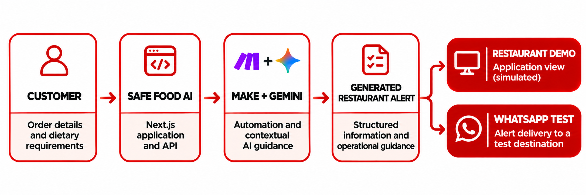

<div align="right">

**English** | [Português](README.pt-BR.md)

</div>

<p align="center">
  
</p>

<p>
  <strong><big><big>SAFE FOOD AI</big></big></strong>
</p>

<p>
  <strong><big>AI-Powered Food Order Communication &amp; Restaurant Alerts</big></strong>
</p>

**SAFE FOOD AI** is a functional MVP that transforms customer-provided dietary requirements and food order instructions into structured, actionable restaurant alerts.

The project explores how generative AI, workflow automation, and application development can improve communication between customers and food preparation teams.

[**Live Demo**](https://safe-food-ai-mu.vercel.app/demo) | [**Technical Audit**](docs/CURSOR_TECHNICAL_AUDIT.md)

---

<p>
  <strong><big><big>Project Documentation</big></big></strong>
</p>

The project documentation provides an in-depth account of the product's origin, design decisions, technical implementation, validation, limitations, and future development.

Documentation is being organized in two languages:

- **Português (pt-BR):** Technical report and development documentation in Portuguese.
- **English (en):** Technical documentation and development report in English.

<p>
  <strong><big>Documentation Chapters</big></strong>
</p>

1. Project Overview and Origin
2. Problem and Opportunity
3. Product Experience and Design
4. System Architecture and Integrations
5. Development Journey
6. AI Engineering and Automation
7. Testing and Validation
8. Security, Ethics, and Limitations
9. Results and Impact
10. Roadmap and Retrospective

*Chapter links will be added as the corresponding documentation files are published.*

---

<p>
  <strong><big><big>1. The Problem</big></big></strong>
</p>

Food delivery orders may include allergies, intolerances, ingredient exclusions, and special preparation requests.

These instructions can be difficult to interpret consistently, particularly when they involve multiple items, modifications, and operational considerations.

Incomplete or ambiguous communication may create additional risks during food preparation, packaging, and transportation.

SAFE FOOD AI explores a structured approach to communicating these requirements.

<p>
  <strong><big><big>2. The Solution</big></big></strong>
</p>

SAFE FOOD AI converts order information into restaurant-oriented alerts and contextual operational guidance.

The MVP combines:

- Structured customer input.
- Rule-based interpretation of dietary declarations.
- Generative AI recommendations.
- Automated workflow execution.
- Restaurant-alert delivery through a simulated application interface and a WhatsApp test destination.

Each request is processed independently, without requiring a customer account or persistent dietary profile.

The application is a communication-support tool, not a food safety certification system.

---

<p>
  <strong><big><big>Customer Interface</big></big></strong>
</p>

The customer-facing interface allows users to provide order details, dietary specifications, ingredient exclusions, and special preparation requests.

Each submission is processed independently, without requiring an account or persistent dietary profile.

<!-- Customer interface screenshot will be added here. -->

<p>
  <strong><big><big>Restaurant View &amp; WhatsApp Test Delivery</big></big></strong>
</p>

Generated restaurant alerts are displayed in the application's simulated restaurant interface and delivered to a WhatsApp test destination through the integrated workflow.

These outputs demonstrate how structured order information and contextual AI-generated guidance can support restaurant communication.

<!-- Restaurant view screenshot will be added here. -->

---

<p>
  <strong><big><big>3. Key Features</big></big></strong>
</p>

<p>
  <strong><big>Structured Order Interpretation</big></strong>
</p>

Processes customer-provided information about:

- Ordered items and quantities.
- Ingredient exclusions.
- Special preparation requests.
- Explicitly declared allergies.
- Explicitly declared intolerances.

The application distinguishes between an ingredient exclusion and a declared medical or dietary condition.

For example, requesting an item "without cheese" does not automatically mean the customer has a milk allergy.

<p>
  <strong><big>Contextual AI Guidance</big></strong>
</p>

Gemini generates contextual suggestions to support restaurant operations, including:

- Food preparation.
- Order assembly.
- Item identification.
- Packaging.
- Transportation.
- Precautions related to declared dietary restrictions.

AI-generated suggestions supplement, rather than replace, human verification.

<p>
  <strong><big>Workflow Automation</big></strong>
</p>

Make orchestrates the external AI-processing workflow.

The application communicates with the automation flow and retrieves the resulting restaurant alert.

<p>
  <strong><big>WhatsApp Test Delivery</big></strong>
</p>

The integrated workflow has been tested to deliver the generated alert to:

1. The application's simulated restaurant interface.
2. A WhatsApp test destination.

These outputs were validated within the MVP's test environment.

<p>
  <strong><big>Controlled Asynchronous Polling</big></strong>
</p>

The application includes a dedicated polling module with:

- A maximum polling duration of 90 seconds.
- Three-second polling intervals.
- AbortController-based request cancellation.
- Handling for temporary network errors.
- Explicit processing-failure handling.
- Cleanup when the component unmounts.

<p>
  <strong><big><big>4. Technology Stack</big></big></strong>
</p>

| Layer | Technologies |
|---|---|
| Frontend | Next.js, React, TypeScript |
| Styling | Tailwind CSS |
| Generative AI | Google Gemini |
| Workflow automation | Make |
| Messaging integration | WhatsApp test destination |
| Request-state management | Upstash Redis |
| Automated testing | Vitest |
| AI-assisted development | Cursor AI |
| Deployment | Vercel |
| Version control | Git, GitHub |

<p>
  <strong><big><big>5. System Architecture</big></big></strong>
</p>

The MVP follows an asynchronous processing workflow.

<p>
  <strong><big>Visual Architecture</big></strong>
</p>

<!-- Add the architecture diagram after uploading it to docs/assets/ -->

<p>
  <strong><big>Technical Workflow</big></strong>
</p>

<p align="center">
  
</p>

The application uses asynchronous status checks to retrieve the generated alert.

The polling implementation includes timeout, cancellation, and failure-handling safeguards.

<p>
  <strong><big><big>6. AI Integration and Human Oversight</big></big></strong>
</p>

Generative AI is used to produce contextual operational recommendations based on order information.

The system is designed to avoid unsupported assumptions about a customer's dietary condition.

Important principles include:

- Allergy labels require an affirmative allergy declaration.
- Intolerance labels require an affirmative intolerance declaration.
- Ingredient exclusions alone do not establish a diagnosis.
- AI-generated precautions do not guarantee the absence of cross-contact.
- Uncertainty and food safety concerns require human verification.

The MVP does not independently verify restaurant ingredients, kitchen conditions, or food handling practices.

<p>
  <strong><big><big>7. Testing and Validation</big></big></strong>
</p>

The project includes automated tests for order interpretation, API protection, and asynchronous restaurant-alert polling.

| Test Suite | Tests | Result |
|---|---:|---|
| Order interpretation | 21 | Passed |
| Restaurant alert API protection | 8 | Passed |
| Restaurant alert polling | 8 | Passed |
| **Total** | **37** | **Passed** |

Local validation also included:

- Successful Next.js production build.
- Successful TypeScript compilation.
- Successful ESLint checks.

The automated tests use controlled scenarios and mocks. They do not independently verify live third-party integrations.

The Make, Gemini, and WhatsApp workflow was also tested end-to-end in the MVP environment.

<p>
  <strong><big><big>8. AI-Assisted Engineering with Cursor</big></big></strong>
</p>

Cursor AI was used to support a focused technical audit of the restaurant-alert polling implementation.

The audit identified reliability risks associated with prolonged polling, request cancellation, and error handling.

The resulting refactor introduced:

- A dedicated polling module.
- Deadline-aware asynchronous operations.
- AbortController-based cancellation.
- Explicit failure handling.
- Automated regression tests.

The implementation passed 37 automated tests and local build and lint validation.

**Read the full technical case study:**

[Cursor AI — Technical Audit and Validation](docs/CURSOR_TECHNICAL_AUDIT.md)

Implementation commit: `761f349`

<p>
  <strong><big><big>9. Running Locally</big></big></strong>
</p>

<p>
  <strong><big>Prerequisites</big></strong>
</p>

- Node.js compatible with the project's Next.js version.
- npm.
- Access to the required external services and credentials for integrated workflows.

<p>
  <strong><big>Installation</big></strong>
</p>

Clone the repository:

```bash id="91a6w4"
git clone https://github.com/gabrielladiogenes/safe-food-ai.git
cd safe-food-ai
```

Install dependencies:

```bash id="5p2vqn"
npm install
```

Configure the required environment variables using your own authorized credentials.

Do not commit `.env.local` or API secrets.

Start the development server:

```bash id="op2ld1"
npm run dev
```

Open:

http://localhost:3000

<p>
  <strong><big>Run Automated Tests</big></strong>
</p>

```bash id="vghbmu"
npx vitest run
```

<p>
  <strong><big>Run Build and Lint Checks</big></strong>
</p>

```bash id="otbd94"
npm run build
npm run lint
```

Some integrated functionality requires correctly configured external services.

<p>
  <strong><big><big>10. Current Scope and Limitations</big></big></strong>
</p>

SAFE FOOD AI is a portfolio MVP and technical demonstration.

Current limitations include:

- No customer registration or persistent dietary profile.
- No independent verification of ingredient composition.
- No guarantee of allergen-free food preparation.
- No confirmed public production adoption or usage metrics.
- External service availability affects integrated workflows.
- Human confirmation remains necessary for uncertain or safety-critical situations.

The application should not be used as the sole basis for decisions about food allergy safety.

<p>
  <strong><big><big>11. Future Improvements</big></big></strong>
</p>

Potential next steps include:

- Expanded integration and failure-recovery tests.
- More systematic evaluation of AI-generated recommendations.
- Prompt versioning and regression evaluation.
- Additional observability for automation failures.
- Stronger server-side input validation.
- More comprehensive accessibility and usability testing.
- Further security hardening before any public production rollout.

These items represent potential improvements, not completed features.

<p>
  <strong><big><big>12. Project Purpose</big></big></strong>
</p>

SAFE FOOD AI was developed as a practical exploration of the intersection between generative AI, business processes, workflow automation, and application development.

The project demonstrates the design and validation of an AI-enabled workflow, from structured input to automated processing and delivery of operational information.

---

**Developed by Gabriella Diógenes**

[GitHub Profile](https://github.com/gabrielladiogenes) | [Live Demo](https://safe-food-ai-mu.vercel.app/demo)
