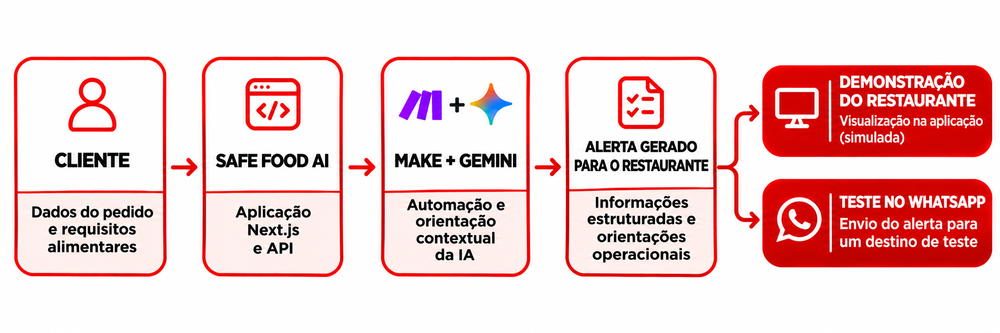
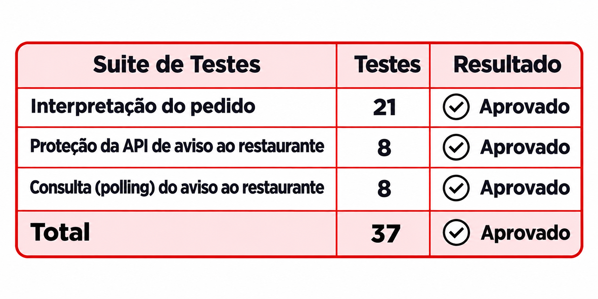

<div align="right">

[English](README.md) | **Português**

</div>

<p align="center">
  
</p>

<p>
  <strong><big><big>SAFE FOOD AI</big></big></strong>
</p>

<p>
  <strong><big>Comunicação Inteligente de Pedidos Alimentares e Alertas para Restaurantes</big></strong>
</p>

Inteligência artificial aplicada à segurança e à experiência alimentar

**O SAFE FOOD AI** é um MVP de solução inteligente que combina IA generativa, automação e interpretação estruturada de dados para transformar restrições alimentares e instruções de pedidos em alertas operacionais claros e recomendações contextualizadas para restaurantes.

Com foco na experiência do consumidor, prevenção de riscos e eficiência operacional, o projeto busca reduzir falhas de comunicação ao longo da jornada do pedido, do preparo à entrega, apoiando decisões mais informadas e práticas de cuidado, com supervisão humana em situações críticas.

[**Demonstração ao vivo**](https://safe-food-ai-mu.vercel.app/demo) | [**Auditoria técnica**](docs/CURSOR_TECHNICAL_AUDIT.md)

---

<p>
  <strong><big><big>Documentação do Projeto</big></big></strong>
</p>

A documentação apresenta, de maneira aprofundada, a origem do produto, as decisões de design, a implementação técnica, os processos de validação, as limitações e as possibilidades de evolução.

A documentação está sendo organizada em dois idiomas:

- **Português (pt-BR):** Relatório técnico e documentação do desenvolvimento em português.
- **Inglês (en):** Documentação técnica e relatório de desenvolvimento em inglês.

<p>
  <strong><big>Capítulos da Documentação</big></strong>
</p>

1. Visão Geral e Origem do Projeto
2. Problema e Oportunidade
3. Experiência do Produto e Design
4. Arquitetura do Sistema e Integrações
5. Jornada de Desenvolvimento
6. Engenharia de IA e Automação
7. Testes e Validação
8. Segurança, Ética e Limitações
9. Resultados e Impacto
10. Roadmap e Retrospectiva

*Os links dos capítulos serão adicionados conforme os respectivos documentos forem publicados.*

---

<p>
  <strong><big><big>1. O Problema</big></big></strong>
</p>

Pedidos realizados por aplicativos de delivery podem incluir alergias, intolerâncias, exclusões de ingredientes e solicitações específicas de preparo.

Essas instruções podem ser difíceis de interpretar de maneira consistente, especialmente quando envolvem vários itens, modificações e cuidados operacionais.

Uma comunicação incompleta ou ambígua pode gerar riscos adicionais durante o preparo, a embalagem e o transporte dos alimentos.

O SAFE FOOD AI explora uma abordagem estruturada para comunicar essas necessidades.

<p>
  <strong><big><big>2. A Solução</big></big></strong>
</p>

O SAFE FOOD AI transforma as informações dos pedidos em avisos direcionados aos restaurantes e orientações operacionais contextualizadas.

O MVP combina:

- Entrada estruturada de informações fornecidas pelo cliente.
- Interpretação de declarações alimentares baseada em regras.
- Recomendações geradas por inteligência artificial.
- Execução automatizada de fluxos de trabalho.
- Entrega de avisos por meio de uma interface simulada do restaurante e de um destino de testes no WhatsApp simultaneamente.

A aplicação funciona como uma ferramenta de apoio à comunicação, não como um sistema de certificação de segurança alimentar.

---

<p>
  <strong><big><big>Interface do Cliente</big></big></strong>
</p>

A interface permite que os usuários informem os detalhes do pedido, suas especificações, exclusões de ingredientes e solicitações especiais de preparo.

Cada envio é processado de maneira independente, sem exigir uma conta ou perfil alimentar persistente.


<p align="center">
  
</p>

<p>
  <strong><big><big>Visualização do Restaurante e Envio de Testes pelo WhatsApp</big></big></strong>
</p>

Os avisos alimentares gerados são apresentados na interface simulada do restaurante e enviados a um destino de testes no WhatsApp por meio do fluxo integrado.

Essas saídas demonstram como informações estruturadas dos pedidos e orientações contextualizadas por IA podem apoiar a comunicação operacional dos restaurantes.

<!-- Uma captura da visualização do restaurante será adicionada aqui. -->

---

<p>
  <strong><big><big>3. Principais Funcionalidades</big></big></strong>
</p>

<p>
  <strong><big>Interpretação Estruturada de Pedidos</big></strong>
</p>

Processa informações fornecidas pelos clientes sobre:

- Itens solicitados e quantidades.
- Exclusões de ingredientes.
- Solicitações especiais de preparo.
- Alergias declaradas explicitamente.
- Intolerâncias declaradas explicitamente.

A aplicação diferencia a exclusão de um ingrediente da declaração de uma condição alimentar ou médica.

Por exemplo, solicitar um alimento "sem queijo" não significa automaticamente que o cliente possui alergia ao leite.

<p>
  <strong><big>Orientações Contextualizadas por IA</big></strong>
</p>

O Gemini gera sugestões contextualizadas para apoiar as operações dos restaurantes, incluindo:

- Preparo dos alimentos.
- Montagem dos pedidos.
- Identificação dos itens.
- Embalagem.
- Transporte.
- Cuidados relacionados às restrições alimentares declaradas.

As sugestões geradas por IA complementam a verificação humana, sem substituí-la.

<p>
  <strong><big>Automação de Fluxos de Trabalho</big></strong>
</p>

O Make orquestra o fluxo externo de processamento com inteligência artificial.

A aplicação se comunica com a automação e recupera o aviso alimentar resultante.

<p>
  <strong><big>Envio de Testes pelo WhatsApp</big></strong>
</p>

O fluxo integrado foi testado para entregar o aviso gerado a dois destinos:

1. Interface simulada do restaurante na aplicação.
2. Destino de testes no WhatsApp.

Essas saídas foram validadas no ambiente de testes do MVP.

<p>
  <strong><big>Consulta Assíncrona Controlada (Polling)</big></strong>
</p>

A aplicação possui um módulo dedicado de consultas assíncronas com:

- Duração máxima de 90 segundos.
- Intervalos de consulta de três segundos.
- Cancelamento de requisições com AbortController.
- Tratamento de erros temporários de rede.
- Tratamento explícito de falhas no processamento.
- Limpeza dos recursos quando o componente é desmontado.

<p>
  <strong><big><big>4. Tecnologias Utilizadas</big></big></strong>
</p>

<p align="center">
  
</p>

<p>
  <strong><big><big>5. Arquitetura do Sistema</big></big></strong>
</p>

O MVP utiliza um fluxo de processamento assíncrono.

<p>
  <strong><big>Arquitetura Visual</big></strong>
</p>

<!-- O diagrama de arquitetura será adicionado após sua publicação em docs/assets/. -->

<p>
  <strong><big>Fluxo Técnico</big></strong>
</p>

<p align="center">
  
</p>

A aplicação utiliza verificações assíncronas de status para recuperar o aviso alimentar gerado.

A implementação do polling inclui mecanismos de proteção relacionados a tempo limite, cancelamento de requisições e tratamento de falhas.

<p>
  <strong><big><big>6. Integração de IA e Supervisão Humana</big></big></strong>
</p>

A inteligência artificial generativa é utilizada para produzir recomendações operacionais contextualizadas com base nas informações dos pedidos.

O sistema foi projetado para evitar suposições não fundamentadas sobre as condições alimentares dos clientes.

Entre os princípios adotados estão:

- A identificação de alergias exige uma declaração afirmativa de alergia.
- A identificação de intolerâncias exige uma declaração afirmativa de intolerância.
- A exclusão de ingredientes, isoladamente, não estabelece um diagnóstico.
- As precauções geradas por IA não garantem a ausência de contato cruzado.
- Situações incertas e questões críticas de segurança alimentar exigem verificação humana.

O MVP não verifica de maneira independente os ingredientes utilizados pelos restaurantes, as condições das cozinhas ou as práticas de manipulação dos alimentos.

<p>
  <strong><big><big>7. Testes e Validação</big></big></strong>
</p>

O projeto inclui testes automatizados para interpretação de pedidos, proteção da API e consultas assíncronas dos avisos alimentares.

<p align="center">
  
</p>

A validação local também incluiu:

- Compilação de produção do Next.js concluída com sucesso.
- Verificação de TypeScript concluída com sucesso.
- Verificações do ESLint concluídas com sucesso.

Os testes automatizados utilizam cenários controlados e mocks. Portanto, não verificam de maneira independente as integrações ativas com serviços externos.

O fluxo integrado entre Make, Gemini e WhatsApp também foi testado de ponta a ponta no ambiente do MVP.

<p>
  <strong><big><big>8. Engenharia Assistida por IA com Cursor</big></big></strong>
</p>

O Cursor AI foi utilizado para apoiar uma auditoria técnica direcionada à implementação do módulo de polling dos avisos alimentares.

A auditoria identificou riscos de confiabilidade relacionados à duração das consultas, ao cancelamento de requisições e ao tratamento de erros.

A refatoração resultante introduziu:

- Um módulo dedicado de polling.
- Operações assíncronas com controle de prazo.
- Cancelamento de requisições com AbortController.
- Tratamento explícito de falhas.
- Testes automatizados de regressão.

A implementação passou por 37 testes automatizados e pelas verificações locais de build e lint.

**Leia o estudo de caso técnico completo:**

[Cursor AI — Auditoria Técnica e Validação](docs/CURSOR_TECHNICAL_AUDIT.md)

Commit da implementação: `761f349`

<p>
  <strong><big><big>9. Executando Localmente</big></big></strong>
</p>

<p>
  <strong><big>Pré-requisitos</big></strong>
</p>

- Node.js compatível com a versão do Next.js utilizada no projeto.
- npm.
- Acesso aos serviços externos e às credenciais necessárias para os fluxos integrados.

<p>
  <strong><big>Instalação</big></strong>
</p>

Clone o repositório:

```bash
git clone https://github.com/gabrielladiogenes/safe-food-ai.git
cd safe-food-ai
```

Instale as dependências:

```bash
npm install
```

Configure as variáveis de ambiente necessárias utilizando suas próprias credenciais autorizadas.

Não publique o arquivo `.env.local` nem chaves de API.

Inicie o servidor de desenvolvimento:

```bash
npm run dev
```

Acesse:

http://localhost:3000

<p>
  <strong><big>Executar Testes Automatizados</big></strong>
</p>

```bash
npx vitest run
```

<p>
  <strong><big>Executar Verificações de Build e Lint</big></strong>
</p>

```bash
npm run build
npm run lint
```

Algumas funcionalidades integradas exigem que os serviços externos estejam corretamente configurados.

<p>
  <strong><big><big>10. Escopo Atual e Limitações</big></big></strong>
</p>

O SAFE FOOD AI é um MVP de portfólio e uma demonstração técnica.

Entre as limitações atuais estão:

- Ausência de cadastro de clientes ou perfil alimentar persistente.
- Ausência de verificação independente da composição dos ingredientes.
- Ausência de garantia de preparo livre de alérgenos.
- Ausência de adoção pública em produção ou métricas de utilização confirmadas.
- Dependência da disponibilidade dos serviços externos para os fluxos integrados.
- Necessidade de confirmação humana em situações incertas ou críticas para a segurança alimentar.

A aplicação não deve ser utilizada como única base para decisões relacionadas à segurança de pessoas com alergias alimentares.

<p>
  <strong><big><big>11. Melhorias Futuras</big></big></strong>
</p>

Entre as possíveis evoluções estão:

- Ampliação dos testes de integração e recuperação de falhas.
- Avaliação mais sistemática das recomendações geradas por IA.
- Versionamento de prompts e avaliação de regressão.
- Maior observabilidade das falhas de automação.
- Validação mais robusta das entradas no servidor.
- Ampliação dos testes de acessibilidade e usabilidade.
- Reforço das medidas de segurança antes de uma eventual disponibilização pública em produção.

Esses itens representam melhorias potenciais, não funcionalidades já concluídas.

<p>
  <strong><big><big>12. Objetivo do Projeto</big></big></strong>
</p>

O SAFE FOOD AI foi desenvolvido como uma exploração prática da conexão entre inteligência artificial generativa, processos de negócios, automação de fluxos de trabalho e desenvolvimento de aplicações.

O projeto demonstra o planejamento, a implementação e a validação de um fluxo operacional habilitado por IA, desde a entrada estruturada de informações até o processamento automatizado e a entrega de orientações operacionais.

---

**Desenvolvido por Gabriella Diógenes**

[Perfil no GitHub](https://github.com/gabrielladiogenes) | [Demonstração ao vivo](https://safe-food-ai-mu.vercel.app/demo)
