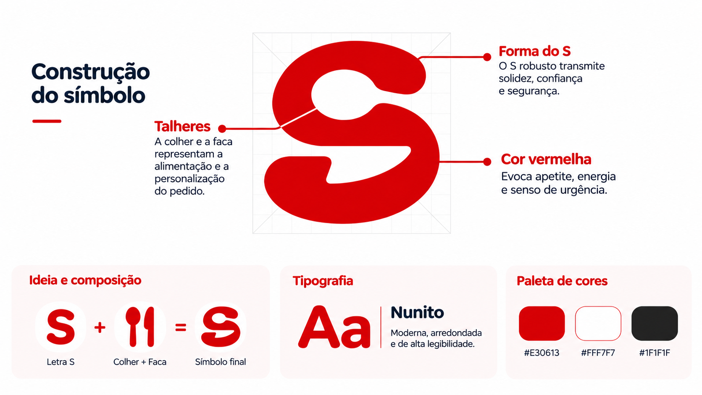

# 03 — Design e Experiência do Produto

  

**SAFE FOOD AI — Identidade visual, direção criativa e experiência digital**

O design do SAFE FOOD AI foi concebido como parte da solução de produto, não apenas como acabamento visual. Diante de um problema que envolve comunicar preferências e necessidades alimentares com clareza, a proposta buscou construir uma experiência direta, reconhecível e coerente com a finalidade do serviço: transformar informações individuais em avisos mais organizados para avaliação humana.

Este capítulo documenta as escolhas de identidade, linguagem visual e interação, incluindo alternativas exploradas, decisões adotadas e limites ainda não validados. A abordagem combina **design orientado a problemas reais**, pensamento de produto e aplicação responsável de inteligência artificial generativa.

**Escopo do capítulo:** identidade visual, exploração criativa, tipografia, cores, animação, UX/UI, jornada, interfaces, feedback e oportunidades de validação. Arquitetura, integrações e implementação detalhada são abordados nos capítulos seguintes.

---

## 3.1 Visão de design e direção criativa

A direção de design do SAFE FOOD AI foi orientada pelo princípio de que **a tecnologia deve simplificar experiências, e não adicionar complexidade a elas**. Desde a concepção, a proposta foi desenvolver uma interface *clean*, intuitiva e funcional, capaz de transformar solicitações alimentares potencialmente complexas em uma experiência de uso simples, organizada e acessível.

A partir dessa premissa, foram adotados princípios de **UX (User Experience) e UI (User Interface) Design**, considerando diferentes perfis e contextos de uso, incluindo **pessoas mais velhas, usuários com pouca familiaridade com ferramentas digitais e indivíduos que precisam realizar solicitações de maneira rápida, em situações de tempo ou atenção limitados**. 

Sob a perspectiva de UX, a abordagem priorizou a facilidade de navegação, a autonomia do usuário e a redução de etapas desnecessárias. Já no âmbito de UI, as decisões se  concentraram na hierarquia visual, na organização dos elementos e na construção de uma interface clara e consistente, buscando minimizar a sobrecarga cognitiva e facilitar a realização das tarefas sem exigir conhecimentos técnicos prévios.

Buscando construir uma identidade visual reconhecível e uma experiência digital descomplicada, na qual **clareza, funcionalidade, inclusão e confiança** orientam as decisões de produto.

Esses princípios representam objetivos de design e hipóteses de usabilidade, cuja efetividade ainda depende de validação com usuários reais.
 
---

## 3.2 Pesquisa visual, referências e moodboarding

A exploração visual reuniu referências de identidades minimalistas, lettering expressivo, símbolos construídos a partir de formas familiares e apresentações editoriais de processos de marca. 

---

## 3.3 Identidade visual e desenvolvimento do símbolo

  

  

A marca partiu da ideia de incorporar **colher e faca** à inicial **S**, unindo dois elementos diretamente relacionados à alimentação a uma forma tipográfica única. A escolha dos talheres também dialoga com a proposta de preferências e necessidades alimentares.

### 3.3.1 Conceito e composição

O processo explorou diferentes desenhos para a letra S e diferentes maneiras de posicionar os talheres. A direção final privilegia a **integração dos elementos na silhueta**, em vez de apresentar utensílios desconectados ao lado do nome.

A síntese visual pode ser descrita como:

**Inicial S + referência à colher e à faca → símbolo integrado da marca.**

### 3.3.2 Forma robusta e personalidade

A letra S apresenta traços espessos, curvas amplas e terminações arredondadas. Na linguagem visual pretendida, essa construção comunica **presença, estabilidade e proximidade**, evitando tanto a rigidez excessiva quanto uma aparência puramente decorativa.

### 3.4 Paleta cromática

A prancha de marca apresenta os seguintes valores:

| Cor | Código apresentado | Função visual proposta |
|---|---|---|
| Vermelho | `#E30613` | Identidade, pontos de atenção e elementos de destaque |
| Branco rosado | `#FFF7F7` | Superfícies claras e contraste suave |
| Grafite | `#1F1F1F` | Texto e elementos de leitura |

O vermelho foi escolhido por sua associação cultural recorrente à energia, ao destaque visual e ao universo da alimentação. 

---

## 3.5 Princípios de experiência do produto

A experiência do SAFE FOOD AI foi orientada por decisões que conectam simplicidade de interação e precisão da informação.

**Contexto por pedido.** As especificações são informadas para a solicitação atual, sem exigir cadastro, login, histórico ou perfil alimentar persistente no MVP.

**Fidelidade às instruções.** A interface deve permitir expressar itens, quantidades, modificações e exclusões sem converter automaticamente preferências em condições médicas.

**Clareza sobre o papel da IA.** Recomendações geradas pelo sistema complementam a comunicação; não substituem avaliação humana ou protocolos de segurança alimentar.

**Redução de atrito.** O formulário busca coletar informações necessárias à solicitação sem introduzir etapas de conta ou configuração permanente que não fazem parte do escopo inicial.

---

## 3.6 Arquitetura da informação e jornada do usuário

O fluxo conceitual do MVP foi organizado para manter o pedido como unidade central da experiência.

| Etapa | Ação ou informação principal | Intenção de UX |
|---|---|---|
| Entrada | Acessar a interface do SAFE FOOD AI | Compreender rapidamente a finalidade da ferramenta |
| Especificação | Informar itens, quantidades e necessidades | Registrar o contexto de um pedido específico |
| Envio | Submeter as informações | Iniciar o processamento com feedback claro |
| Processamento | Aguardar interpretação e geração de orientações | Tornar o estado do sistema compreensível |
| Resultado | Apresentar ou encaminhar o aviso estruturado | Organizar informações para avaliação humana |
| Comunicação demonstrativa | Visualizar a representação destinada ao estabelecimento | Mostrar continuidade entre pedido e orientação operacional |

A jornada não representa integração comercial com uma plataforma de delivery. O MVP demonstra um fluxo independente e seus destinos de teste.
 

### 3.6.1 Hierarquia da informação

A organização prioriza a distinção entre **dados fornecidos pelo consumidor**, **interpretação estruturada** e **orientações complementares geradas por IA**. Essa separação é essencial para que uma sugestão não seja confundida com uma declaração original do usuário ou uma confirmação do restaurante.

### 3.6.2 Pontos de atenção

Pedidos com vários itens podem conter instruções aplicáveis apenas a uma unidade ou porção. A experiência precisa preservar essas relações. Também deve reconhecer quando a informação não é suficiente para produzir uma orientação confiável, encaminhando a necessidade de confirmação humana.

---

## 3.7 Interface do consumidor e desenho do formulário

A interface do consumidor combina apresentação de marca e coleta de informações alimentares. O título animado e o formulário foram refinados ao longo do desenvolvimento, preservando uma estrutura voltada ao registro de solicitações específicas.

### 3.8 Formulário orientado ao pedido

O desenho privilegia a inserção das informações relevantes no momento da solicitação. Isso atende à decisão de escopo de não manter um perfil alimentar persistente: uma exclusão ou preferência em um pedido não deve ser presumida como regra permanente para todos os pedidos futuros.

### 3.8.1 Linguagem e prevenção de inferências

O produto diferencia **exclusões de ingredientes** de **alergias e intolerâncias declaradas afirmativamente**. Por exemplo, solicitar um item sem determinado ingrediente não autoriza o sistema a concluir que o consumidor possui alergia ou intolerância.

Essa distinção não é apenas uma regra de processamento; é uma decisão de experiência e confiança. O design precisa comunicar com clareza o que foi informado, o que foi interpretado e o que permanece sujeito à confirmação.

### 3.8.2 Equilíbrio entre personalidade e função

A marca e o movimento conferem personalidade à abertura, enquanto os campos e as mensagens devem manter prioridade funcional. O objetivo é que a experiência seja expressiva, mas que a informação crítica continue fácil de localizar e compreender.

---

## 3.9 Interface do estabelecimento e experiência de comunicação

A solução também contempla uma **interface demonstrativa de visualização do restaurante** e o encaminhamento de avisos a um **destino de testes no WhatsApp**. disparado simultaneamente a simulação. Esses elementos foram desenvolvidos para demonstrar a continuidade da informação entre a entrada do consumidor e sua apresentação em formato operacional.

 
### 3.9.1 Da solicitação ao aviso

A experiência do estabelecimento deve facilitar a identificação de itens, quantidades, exclusões e orientações pertinentes. O formato de apresentação procura reduzir a dependência de um texto livre extenso, mantendo visíveis as informações que demandam atenção.

### 3.9.2 Representação no WhatsApp

Os registros incluem refinamentos da apresentação de mensagens em um contexto visual de smartphone. O objetivo da simulação é tornar a demonstração mais compreensível, não sugerir que exista uma integração oficial com restaurantes ou plataformas de delivery.

### 3.9.3 Responsabilidade operacional

A interface não confirma que o estabelecimento leu, aceitou ou executou as orientações. A viabilidade de preparo, os ingredientes, os procedimentos internos e os cuidados de segurança alimentar permanecem sujeitos à avaliação e à responsabilidade humana.

 
---

## 3.10 Estados de interação, feedback e erros

Um produto que processa informações por meio de IA e automação precisa tornar seus estados visíveis. Os registros do MVP incluem atenção a processamento, envio, conclusão, falhas, tempo limite e cancelamento.

| Estado | Necessidade de comunicação |
|---|---|
| Antes do envio | Explicar quais informações são solicitadas |
| Processamento | Indicar que a solicitação está em andamento |
| Conclusão | Distinguir processamento concluído de pedido efetivamente atendido |
| Falha | Informar que o fluxo não pôde ser concluído sem simular sucesso |
| Tempo limite | Evitar espera indefinida e orientar nova tentativa quando apropriado |
| Cancelamento | Encerrar o estado de espera de forma compreensível |
| Informação insuficiente | Sinalizar a necessidade de esclarecimento ou avaliação humana |

---

## 3.11 Responsividade e acessibilidade

O projeto foi concebido como uma experiência web, com apresentação funcional das interfaces em diferentes contextos de visualização, como desktop, smartfones ou tablets.
