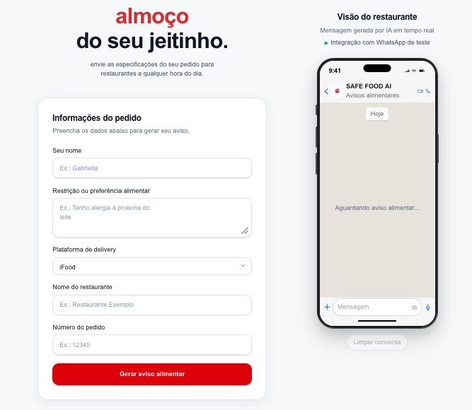

# 03 — Design e Experiência do Produto

  

**SAFE FOOD AI — Identidade visual, direção criativa, motion design e experiência digital**

O design do SAFE FOOD AI foi concebido como parte da solução de produto, não apenas como acabamento visual. Diante de um problema que envolve comunicar preferências e necessidades alimentares com clareza, a proposta buscou construir uma experiência direta, reconhecível e coerente com a finalidade do serviço: transformar informações individuais em avisos mais organizados para avaliação humana.

Este capítulo documenta as escolhas de identidade, linguagem visual e interação, incluindo alternativas exploradas, decisões adotadas e limites ainda não validados. A abordagem combina **design orientado a problemas reais**, pensamento de produto e aplicação responsável de inteligência artificial generativa.

**Escopo do capítulo:** identidade visual, exploração criativa, tipografia, cores, animação, UX/UI, jornada, interfaces, feedback e oportunidades de validação. Arquitetura, integrações e implementação detalhada são abordados nos capítulos seguintes.

---

## 3.1 Visão de design e direção criativa

A proposta de design parte de uma tensão: solicitações alimentares podem ser simples de escrever, mas complexas de interpretar e executar. Por isso, a experiência precisa acolher a personalização sem sugerir que o sistema possa garantir o preparo seguro de um alimento.

A direção criativa buscou equilibrar três atributos:

- **Reconhecimento:** uma marca com símbolo próprio, legível e associado ao universo da alimentação.
- **Clareza:** uma interface que privilegia o conteúdo do pedido, com hierarquia visual e instruções compreensíveis.
- **Responsabilidade:** uma comunicação que distingue sugestões automatizadas de decisões que dependem do estabelecimento.

A identidade utiliza um repertório visual acessível e expressivo. O símbolo vermelho e a tipografia arredondada conferem personalidade, enquanto o fundo predominantemente claro mantém a leitura como prioridade. Essas características representam intenções de design; sua percepção por usuários ainda precisa ser investigada.

---

## 3.2 Pesquisa visual, referências e moodboarding

A exploração visual reuniu referências de identidades minimalistas, lettering expressivo, símbolos construídos a partir de formas familiares e apresentações editoriais de processos de marca. O objetivo não era reproduzir uma referência, mas encontrar uma linguagem adequada à proposta do SAFE FOOD AI.

### 3.2.1 Territórios visuais explorados

- **Marcas tipográficas:** letras com personalidade e formas reconhecíveis.
- **Símbolos integrados:** combinação de inicial e elementos figurativos em uma única forma.
- **Identidade editorial:** composições com respiro, anotações de construção e apresentação objetiva de decisões.
- **Motion branding:** movimento como recurso de introdução da marca e de comunicação do produto.
- **Interfaces funcionais:** organização visual de formulários e informações específicas de cada pedido.

O processo incluiu múltiplas propostas e refinamentos do símbolo, da letra S e da presença dos talheres. As referências e explorações são tratadas aqui como registros de direção criativa; não há, nesta documentação, uma pesquisa formal de preferência visual com participantes.

### 3.2.2 Do moodboard à decisão

O critério central de seleção foi a capacidade de conectar **alimentação, individualidade e identidade de marca** sem recorrer a ícones genéricos de inteligência artificial. A exploração evoluiu de combinações mais literais para uma forma integrada e sintética.

Uma prancha editorial de referências pode complementar esta seção futuramente, desde que suas imagens e respectivas fontes sejam identificadas. Uma eventual reconstrução do moodboard deverá ser apresentada como tal, e não como registro original contemporâneo a todas as decisões.

---

## 3.3 Identidade visual e desenvolvimento do símbolo

  

  

A marca partiu da ideia de incorporar **colher e faca** à inicial **S**, unindo dois elementos diretamente relacionados à alimentação a uma forma tipográfica única. A escolha dos talheres também dialoga com a proposta de pedidos individualizados: um mesmo contexto alimentar pode envolver instruções diferentes para cada pessoa e cada item.

### 3.3.1 Conceito e composição

O processo explorou diferentes desenhos para a letra S e diferentes maneiras de posicionar os talheres. A direção final privilegia a **integração dos elementos na silhueta**, em vez de apresentar utensílios desconectados ao lado do nome.

A síntese visual pode ser descrita como:

**Inicial S + referência à colher e à faca → símbolo integrado da marca.**

O resultado busca criar uma associação imediata com o universo alimentar, preservando uma assinatura visual própria.

### 3.3.2 Forma robusta e personalidade

A letra S apresenta traços espessos, curvas amplas e terminações arredondadas. Na linguagem visual pretendida, essa construção comunica **presença, estabilidade e proximidade**, evitando tanto a rigidez excessiva quanto uma aparência puramente decorativa.

A robustez também favorece a identificação da silhueta em diferentes contextos de aplicação. Entretanto, legibilidade em tamanhos reduzidos e reconhecimento espontâneo do símbolo são aspectos que ainda exigem testes específicos; não devem ser considerados resultados já comprovados.

### 3.3.3 Refinamento geométrico

Durante a apresentação da identidade, foram exploradas pranchas com grid de construção, alinhamentos e marcações de forma. O refinamento priorizou um **vermelho sólido**, sem linhas sobrepostas à área preenchida do símbolo, e um grid externo discreto para evidenciar sua composição.

A prancha demonstra intenção de consistência geométrica, mas não constitui, por si só, comprovação de simetria matemática ou especificação vetorial de produção.

---

## 3.4 Tipografia, cores e linguagem visual

### 3.4.1 Tipografia

A prancha de identidade identifica **Nunito** como referência tipográfica, caracterizada por desenho arredondado e aparência contemporânea. Sua escolha visual conversa com as curvas do símbolo e com a intenção de uma interface acessível e próxima.

Na documentação, é importante diferenciar a **tipografia apresentada no material de marca** das fontes efetivamente carregadas no aplicativo. A confirmação das famílias, pesos e tamanhos implementados deve ser feita nos arquivos de estilos e configuração do projeto.

A hierarquia visual proposta distingue títulos, instruções, rótulos de campos, mensagens de status e avisos. Em um produto que recebe especificações detalhadas, tipografia deve facilitar a leitura antes de funcionar como elemento ornamental.

### 3.4.2 Paleta cromática

A prancha de marca apresenta os seguintes valores:

| Cor | Código apresentado | Função visual proposta |
|---|---|---|
| Vermelho | `#E30613` | Identidade, pontos de atenção e elementos de destaque |
| Branco rosado | `#FFF7F7` | Superfícies claras e contraste suave |
| Grafite | `#1F1F1F` | Texto e elementos de leitura |

Os códigos acima correspondem à **prancha de identidade**, e não devem ser tratados automaticamente como inventário exaustivo dos tokens de interface implementados.

O vermelho foi escolhido por sua associação cultural recorrente à energia, ao destaque visual e ao universo da alimentação. Também é frequentemente utilizado em comunicação comercial para atrair atenção e sugerir urgência. **Isso não significa que a cor aumente universalmente o apetite ou produza o mesmo efeito em todas as pessoas**; tais associações dependem de contexto e não foram testadas neste projeto.

### 3.4.3 Consistência visual

A linguagem proposta combina formas arredondadas, espaços em branco, contraste entre texto escuro e superfícies claras e uso seletivo do vermelho. O objetivo é permitir que a marca seja expressiva sem competir com as instruções alimentares, que são o conteúdo prioritário da experiência.

---

## 3.5 Motion design e experiência de marca animada

A identidade foi explorada também como experiência em movimento. Os registros de desenvolvimento incluem a ideia de uma sequência animada que apresenta o símbolo, revela o nome SAFE FOOD e conecta a marca a diferentes momentos de consumo.

### 3.5.1 Conceito da animação

A narrativa visual registrada contempla uma progressão entre **símbolo**, **nome da marca** e **mensagem dinâmica**, com referências a café, almoço, lanche e janta. Foram exploradas transições com rotação e implosão, composição horizontal compacta, fundo claro e repetição em loop.

Essa escolha procura transformar a abertura da interface em uma introdução breve ao universo do produto. A animação não deve dificultar o preenchimento do formulário nem competir com a compreensão das instruções.

### 3.5.2 Função na experiência

O movimento cumpre duas funções propostas:

1. **Expressão de identidade:** tornar a marca reconhecível para além de uma imagem estática.
2. **Contextualização:** relacionar a solução a diferentes ocasiões alimentares sem restringi-la a um único tipo de refeição.

A animação deve ser avaliada também sob critérios de duração, legibilidade, desempenho e preferência por movimento reduzido. Não há evidência registrada de testes formais desses aspectos com usuários.

### 3.5.3 Evidência visual

  

*Figura 3.2 — Animação desenvolvida para a experiência visual do SAFE FOOD AI, conectando identidade de marca e contexto alimentar.*

O arquivo `SAFEFOOD-MOTION.gif` documenta a exploração de movimento da marca e sua aplicação na experiência.

A presença do GIF permite apresentar visualmente a proposta de motion branding, complementando a descrição das decisões criativas.

---

## 3.6 Princípios de experiência do produto

A experiência do SAFE FOOD AI foi orientada por decisões que conectam simplicidade de interação e precisão da informação.

**Contexto por pedido.** As especificações são informadas para a solicitação atual, sem exigir cadastro, login, histórico ou perfil alimentar persistente no MVP.

**Fidelidade às instruções.** A interface deve permitir expressar itens, quantidades, modificações e exclusões sem converter automaticamente preferências em condições médicas.

**Clareza sobre o papel da IA.** Recomendações geradas pelo sistema complementam a comunicação; não substituem avaliação humana ou protocolos de segurança alimentar.

**Feedback visível.** O usuário precisa compreender quando uma solicitação está sendo processada, concluída ou não pôde ser finalizada.

**Redução de atrito.** O formulário busca coletar informações necessárias à solicitação sem introduzir etapas de conta ou configuração permanente que não fazem parte do escopo inicial.

Esses princípios orientam o desenho do produto, mas ainda não constituem evidência de facilidade de uso ou satisfação comprovada.

---

## 3.7 Arquitetura da informação e jornada do usuário

O fluxo conceitual do MVP foi organizado para manter o pedido como unidade central da experiência.

| Etapa | Ação ou informação principal | Intenção de UX |
|---|---|---|
| Entrada | Acessar a interface do SAFE FOOD AI | Compreender rapidamente a finalidade da ferramenta |
| Especificação | Informar itens, quantidades e necessidades | Registrar o contexto de um pedido específico |
| Envio | Submeter as informações | Iniciar o processamento com feedback claro |
| Processamento | Aguardar interpretação e geração de orientações | Tornar o estado do sistema compreensível |
| Resultado | Apresentar ou encaminhar o aviso estruturado | Organizar informações para avaliação humana |
| Comunicação demonstrativa | Visualizar a representação destinada ao estabelecimento | Mostrar continuidade entre pedido e orientação operacional |

A jornada não representa integração comercial com uma plataforma de delivery. O MVP demonstra um fluxo independente e seus destinos de teste.

### 3.7.1 Hierarquia da informação

A organização prioriza a distinção entre **dados fornecidos pelo consumidor**, **interpretação estruturada** e **orientações complementares geradas por IA**. Essa separação é essencial para que uma sugestão não seja confundida com uma declaração original do usuário ou uma confirmação do restaurante.

### 3.7.2 Pontos de atenção

Pedidos com vários itens podem conter instruções aplicáveis apenas a uma unidade ou porção. A experiência precisa preservar essas relações. Também deve reconhecer quando a informação não é suficiente para produzir uma orientação confiável, encaminhando a necessidade de confirmação humana.

---

## 3.8 Interface do consumidor e desenho do formulário

  

*Figura 3.3 — Interface do consumidor do SAFE FOOD AI, com identidade visual e formulário de especificações alimentares.*

A interface do consumidor combina apresentação de marca e coleta de informações alimentares. O título animado e o formulário foram refinados ao longo do desenvolvimento, preservando uma estrutura voltada ao registro de solicitações específicas.

### 3.8.1 Formulário orientado ao pedido

O desenho privilegia a inserção das informações relevantes no momento da solicitação. Isso atende à decisão de escopo de não manter um perfil alimentar persistente: uma exclusão ou preferência em um pedido não deve ser presumida como regra permanente para todos os pedidos futuros.

### 3.8.2 Linguagem e prevenção de inferências

O produto diferencia **exclusões de ingredientes** de **alergias e intolerâncias declaradas afirmativamente**. Por exemplo, solicitar um item sem determinado ingrediente não autoriza o sistema a concluir que o consumidor possui alergia ou intolerância.

Essa distinção não é apenas uma regra de processamento; é uma decisão de experiência e confiança. O design precisa comunicar com clareza o que foi informado, o que foi interpretado e o que permanece sujeito à confirmação.

### 3.8.3 Equilíbrio entre personalidade e função

A marca e o movimento conferem personalidade à abertura, enquanto os campos e as mensagens devem manter prioridade funcional. O objetivo é que a experiência seja expressiva, mas que a informação crítica continue fácil de localizar e compreender.

---

## 3.9 Interface do estabelecimento e experiência de comunicação

A solução também contempla uma **interface demonstrativa de visualização do restaurante** e o encaminhamento de avisos a um **destino de testes no WhatsApp**. Esses elementos foram desenvolvidos para demonstrar a continuidade da informação entre a entrada do consumidor e sua apresentação em formato operacional.

### 3.9.1 Da solicitação ao aviso

A experiência do estabelecimento deve facilitar a identificação de itens, quantidades, exclusões e orientações pertinentes. O formato de apresentação procura reduzir a dependência de um texto livre extenso, mantendo visíveis as informações que demandam atenção.

### 3.9.2 Representação no WhatsApp

Os registros incluem refinamentos da apresentação de mensagens em um contexto visual de smartphone. O objetivo da simulação é tornar a demonstração mais compreensível, não sugerir que exista uma integração oficial com restaurantes ou plataformas de delivery.

### 3.9.3 Responsabilidade operacional

A interface não confirma que o estabelecimento leu, aceitou ou executou as orientações. A viabilidade de preparo, os ingredientes, os procedimentos internos e os cuidados de segurança alimentar permanecem sujeitos à avaliação e à responsabilidade humana.

---

## 3.10 Estados de interação, feedback e erros

Um produto que processa informações por meio de IA e automação precisa tornar seus estados visíveis. Os registros do MVP incluem atenção a processamento, envio, conclusão, falhas, tempo limite e cancelamento.

| Estado | Necessidade de comunicação |
|---|---|
| Antes do envio | Explicar quais informações são solicitadas |
| Processamento | Indicar que a solicitação está em andamento |
| Conclusão | Distinguir processamento concluído de pedido efetivamente atendido |
| Falha | Informar que o fluxo não pôde ser concluído sem simular sucesso |
| Tempo limite | Evitar espera indefinida e orientar nova tentativa quando apropriado |
| Cancelamento | Encerrar o estado de espera de forma compreensível |
| Informação insuficiente | Sinalizar a necessidade de esclarecimento ou avaliação humana |

A distinção mais importante é entre **sucesso técnico** e **segurança ou execução do pedido**. Uma mensagem de sucesso não deve ser interpretada como confirmação de que o alimento foi preparado corretamente.

---

## 3.11 Responsividade e acessibilidade

O projeto foi concebido como uma experiência web, com atenção à apresentação das interfaces em diferentes contextos de visualização, incluindo representações em smartphone.

Do ponto de vista de design, os principais critérios a verificar são:

- Leitura confortável de textos e instruções em telas menores.
- Hierarquia visual consistente entre campos, alertas e resultados.
- Contraste adequado entre texto, superfícies e elementos de destaque.
- Rótulos compreensíveis e mensagens de erro específicas.
- Navegação por teclado e estados de foco identificáveis.
- Respeito às preferências de redução de movimento nas animações.
- Evitar que a cor, isoladamente, seja o único meio de comunicar uma condição.

Esses itens são **critérios de avaliação**, não uma declaração de conformidade já auditada. A verificação técnica e os testes de acessibilidade devem ser documentados com evidências no capítulo de validação.

---

## 3.12 Decisões, alternativas e iterações

O histórico de design do SAFE FOOD AI é relevante porque revela decisões progressivas, e não apenas uma interface finalizada.

| Problema ou objetivo | Exploração | Decisão registrada | Aprendizado ou limite |
|---|---|---|---|
| Criar uma identidade própria | Variações de letra S, tipografia e talheres | Símbolo integrado com S, colher e faca | A identidade deve dialogar com o contexto alimentar sem depender de ícones genéricos de IA |
| Equilibrar personalidade e legibilidade | Diferentes espessuras e desenhos do S | Silhueta robusta, curvas amplas e acabamento arredondado | Reconhecimento em escala reduzida ainda precisa ser testado |
| Explicar a construção da marca | Pranchas editoriais e grids | Grid discreto, símbolo vermelho sólido e anotações externas | A prancha apresenta a intenção geométrica, não uma certificação de simetria |
| Tornar a abertura mais expressiva | Sequências e transições de marca | Exploração de motion e mensagem dinâmica por refeição | O movimento deve ser avaliado quanto à legibilidade e à acessibilidade |
| Reduzir etapas desnecessárias | Possibilidades de personalização e registro | Formulário contextual por pedido, sem cadastro persistente | Menor escopo de dados não elimina a necessidade de clareza e proteção |
| Evitar interpretações indevidas | Tratamento de exclusões e declarações alimentares | Não inferir alergia ou intolerância de simples exclusões | Linguagem de interface e regras de interpretação precisam permanecer alinhadas |
| Demonstrar continuidade operacional | Interface do restaurante e apresentação no WhatsApp | Destinos demonstrativos de visualização e testes | Uma demonstração não comprova adoção ou execução real pelo estabelecimento |
| Comunicar falhas | Estados de espera, conclusão e erro | Tratamento de situações de processamento e interrupção | É necessário testar se as mensagens são compreendidas por usuários |

A evolução detalhada por versões, incluindo implementação e correções técnicas, será apresentada no **Capítulo 05 — Jornada de Desenvolvimento**.

---

## 3.13 Resultados de design e validações futuras

### 3.13.1 Entregas documentadas

O processo produziu uma direção de marca reconhecível, explorações e refinamentos do símbolo, uma prancha de construção visual, uma experiência de abertura com elementos animados, um formulário contextualizado e representações da comunicação com o estabelecimento.

Essas entregas demonstram **materialização de decisões de design** e sua conexão com uma proposta funcional de produto. Não demonstram, por si só, aumento de confiança, redução de erros ou preferência do público pela interface.

### 3.13.2 Perguntas para validação com usuários

A próxima etapa de pesquisa de experiência poderá investigar:

1. Os consumidores compreendem a finalidade do produto antes de preencher o formulário?
2. Conseguem diferenciar preferências, exclusões e declarações de alergias ou intolerâncias?
3. A organização das informações facilita a revisão de pedidos com múltiplos itens?
4. As mensagens de processamento, conclusão e falha são compreensíveis?
5. A apresentação do aviso deixa claro o que depende de confirmação humana?
6. A animação contribui para a compreensão ou introduz distração?
7. Os estabelecimentos conseguem localizar rapidamente as instruções relevantes?

As respostas exigirão testes com participantes, critérios de avaliação definidos e registro de evidências. Até lá, os benefícios de experiência permanecem como hipóteses.

---

## 3.14 Síntese: design como parte da solução

No SAFE FOOD AI, design e experiência do produto foram tratados como instrumentos para tornar uma necessidade individual mais fácil de expressar, interpretar e comunicar. A identidade visual foi construída a partir de elementos do universo alimentar; o motion amplia a expressão da marca; e a interface organiza a interação em torno de um pedido específico.

A principal decisão de produto foi não confundir **personalização** com **presunção**. A experiência procura acolher informações individuais sem atribuir condições médicas não declaradas e sem sugerir que a tecnologia substitui a confirmação do estabelecimento.

Sob a perspectiva de inteligência artificial aplicada a negócios, o capítulo demonstra como direção criativa, UX e pensamento de produto podem trabalhar em conjunto: **identificar uma fricção real, construir uma experiência coerente, explicitar seus limites e formular hipóteses que possam ser testadas**.

O próximo capítulo apresenta a arquitetura e as integrações que sustentam essa experiência.
